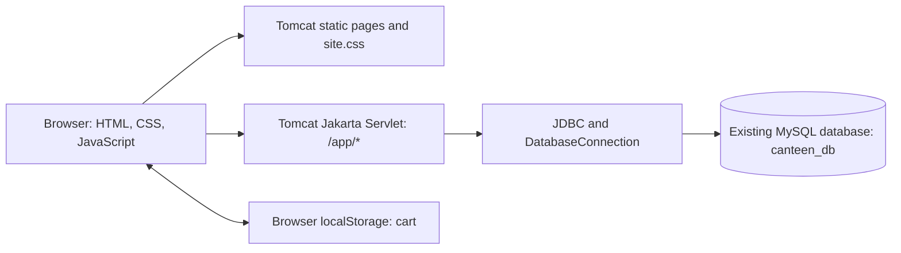
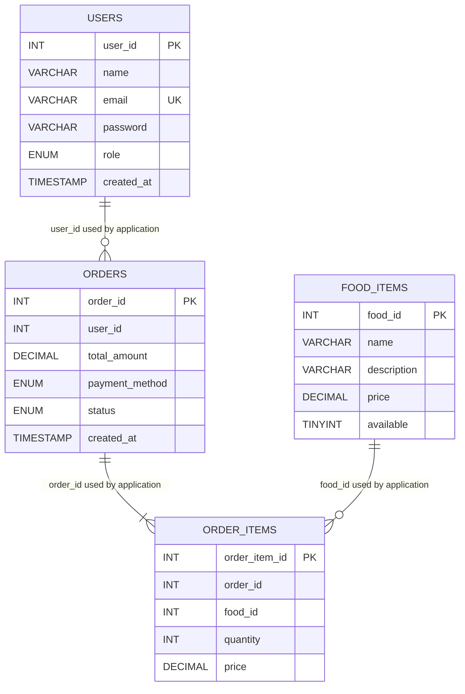

# CodeCravers Canteen Food Ordering System

## 1. Abstract

CodeCravers Canteen is a Java web application for browsing a college canteen
menu and preparing food orders. The project combines HTML, CSS, and JavaScript
pages with Java Servlets and JDBC. Its intended database is the existing
MySQL database `canteen_db`; the application does not create or replace that
database.

The current code includes a student account flow, a browser-based cart, server
endpoints for menu and order operations, and an admin screen. Java compiles
against the Servlet API supplied by Tomcat. However, the database credentials
are not configured in the current environment, so database-backed actions have
not been verified against MySQL. This report distinguishes implemented code
from features that have actually been tested.

## 2. Problem Statement

Taking canteen orders manually can create queues and make it harder for
students and canteen staff to keep track of selected items, prices, and order
progress. A small web application can let a student review food items and
prepare an order, while giving authorized staff a place to review submitted
orders.

## 3. Objectives

- Keep the existing CodeCravers Canteen homepage, menu, and cart while using the updated orange, cream, and charcoal theme.
- Display the existing sample foods if database menu access is unavailable.
- Provide student registration and login using hashed passwords.
- Keep account identity and role in a server-side session after login.
- Read menu items and current prices from the existing database when connected.
- Let a student adjust a cart and submit food IDs and quantities for checkout.
- Calculate order totals on the server and save orders with their items in a
  database transaction.
- Let students view their own order history and bill.
- Provide admin controls to add or edit food, change its availability, inspect
  recent orders, and update order statuses confirmed for the existing schema.
- Document the project and its current verification limits honestly.

## 4. Existing and Proposed System

### Existing system

The starting project consisted of static homepage and menu pages, a Java
servlet example, and an existing MySQL database. The menu added items to
browser `localStorage`; the original cart data used the `cart` key and records
with `name`, `price`, and `quantity`. There was no usable database-backed
account, order, or administration flow in that starting version.

### Proposed system

The current implementation keeps those pages and extends them with a Java
Servlet endpoint. The browser requests menu data and sends form submissions to
the servlet. The servlet is written to use JDBC prepared statements, hashed
passwords, session role checks, and a transaction for saving an order and its
items. The admin controls are restricted in Java by the signed-in account role.

This design describes code that is present; it does not imply that all database
operations are operational in this environment. Maven and database
configuration are unavailable, so full end-to-end validation remains pending.

## 5. Technologies Used

- **HTML** — page structure and forms.
- **CSS** — warm orange, cream, and charcoal visual theme with responsive layouts.
- **JavaScript** — cart storage and interaction, and requesting menu data.
- **Java** — servlet request handling and application logic.
- **Jakarta Servlet 6.0** — servlet API provided by Apache Tomcat 10.1.
- **JDBC** — Java database access with `PreparedStatement`.
- **MySQL** — existing `canteen_db` database.
- **MySQL Connector/J 8.4.0** — declared as a Maven runtime dependency.
- **Maven** — intended WAR packaging tool; not available in the current
  environment, so the WAR has not been built here.
- **Apache Tomcat 10.1** — web server and servlet container.

No frontend framework or real payment gateway is used. The `ONLINE` payment
choice is labelled as simulated and does not collect payment information.

## 6. Main Modules

### Homepage and menu

The homepage keeps its hero and uses orange, cream, and charcoal shared styles.
Navigation and feature icons are inline SVG with visible text labels. The
project includes local food photographs under `assets/food/`, with photo
attributions in `assets/food/PHOTO-CREDITS.txt`.

The menu includes 24 example dishes in four searchable/filterable categories.
It requests `/app/menu-data`; non-empty database results replace the examples.
If the endpoint is unavailable or the database has no food rows, the page
clearly labels the examples as sample dishes that are not stored in MySQL.
Sample items have no invented food IDs. Categories for live database rows are
inferred from their names because the confirmed `food_items` schema has no
category column.

### Student registration and login

The servlet validates a name, email, and password before registration. New
passwords are hashed using PBKDF2-HMAC-SHA256 with a random salt before being
stored. Login checks the entered password against the saved hash and puts the
user ID, display name, and role into a server-side session.

Existing password formats were not inspected. Accounts whose stored passwords
are not in this project's PBKDF2 format may not be able to log in.

### Shopping cart and checkout

The cart retains the browser storage key `cart`. It can show quantities and
prices, adjust quantities, remove items, and clear the cart. The checkout form
sends food IDs and quantities, not authoritative prices. The servlet is written
to read the current prices and availability from MySQL, calculate the total,
and insert the order and its item rows in one transaction. It accepts `CASH`
or `ONLINE`; `ONLINE` is simulation only.

### Student orders and bill

The servlet includes order-history and bill handlers. The database query for
history filters by the signed-in user's ID. Bill lookup also checks both the
order ID and signed-in user's ID. The bill code displays order items, unit
prices, quantities, subtotals, total, payment type, status, and time from the
existing table columns. These database flows have not been tested against the
live database.

### Admin

An account with role `ADMIN` is permitted by the servlet to view recent orders
and use food-management controls to add or edit a food item or change its
availability. Admin order controls only offer `PLACED`, `ACCEPTED`, and
`PREPARING`, the statuses confirmed for the existing schema. No unconfirmed
status is assumed. Food is marked unavailable rather than deleted, to avoid
breaking existing order references.

### Kitchen staff

The confirmed `users.role` enum contains `STUDENT` and `ADMIN`; it does not
confirm a separate kitchen role. Therefore this implementation does not provide
a distinct kitchen-staff account or dashboard. An authorized admin can access
the order list and preparation-status controls. A separate kitchen role would
require an explicitly approved database change and is outside the current
schema.

## 7. Database Design

The application uses the existing database `canteen_db`. The following column
names and types are based on the user's Workbench descriptions. No schema was
created or altered by this project.

| Table | Confirmed columns | Purpose in the application |
|---|---|---|
| `users` | `user_id INT` primary key, auto-increment; `name VARCHAR(100)`; `email VARCHAR(100)` unique; `password VARCHAR(255)`; `role ENUM('STUDENT','ADMIN')` default `STUDENT`; `created_at TIMESTAMP` | Stores student/admin account details and password hash. |
| `food_items` | `food_id INT` primary key, auto-increment; `name VARCHAR(100)`; `description VARCHAR(255)`; `price DECIMAL(10,2)`; `available TINYINT(1)` default `1` | Stores menu item details, current prices, and availability. |
| `orders` | `order_id INT` primary key, auto-increment; `user_id INT`; `total_amount DECIMAL(10,2)`; `payment_method ENUM('CASH','ONLINE')` default `CASH`; `status` enum including confirmed values `PLACED`, `ACCEPTED`, `PREPARING`; `created_at TIMESTAMP` | Stores who placed an order, its total, payment choice, status, and time. Other status enum values were not fully confirmed and are not used by the code. |
| `order_items` | `order_item_id INT` primary key, auto-increment; `order_id INT`; `food_id INT`; `quantity INT`; `price DECIMAL(10,2)` | Stores the food rows and price-at-order used for each order. |

The code uses the ID columns as relationships: an order's `user_id` identifies a
user, and each order item uses `order_id` and `food_id` to identify its parent
order and food. The actual foreign-key definitions and referential actions were
not independently inspected in this workspace; the relationships here describe
how the application queries the tables. The checkout code also expects MySQL to
return the generated `order_id` after an insert.

The current database helper reads `CANTEEN_DB_URL`, `CANTEEN_DB_USER`, and
`CANTEEN_DB_PASSWORD` from the process environment. The password is not written
in Java source or this report.

## 8. System Workflow

1. A visitor opens the homepage and follows the menu link.
2. The menu page requests menu data from the servlet. If the database request
   succeeds, database items and their availability replace the sample cards.
   If it fails, the page keeps the sample menu and shows a status message.
3. A visitor adds items to the browser cart. Cart entries preserve the existing
   `cart` localStorage key and include the name, displayed price, and quantity;
   database menu items also carry their food ID.
4. A student registers or logs in. The servlet validates inputs, verifies a
   password hash, and stores the signed-in user identity and role in a session.
5. At checkout, the browser sends food IDs, quantities, payment choice, and
   request tokens. The servlet verifies the session and input, checks each food
   item is available, reads current prices from MySQL, and calculates the
   total.
6. The servlet saves the order and its item rows in one transaction. If a
   database write fails, it attempts to roll back the transaction.
7. The student is sent to a bill view and can later view order history. Each
   student order query is restricted to that student's user ID.
8. An admin session can open the dashboard to manage food availability/details
   and update orders to one of the confirmed statuses.

Steps involving MySQL are implemented in code but have not been exercised
against the database in the current environment.

## 9. Testing and Verification Results

The following checks were actually run in the available environment:

| Test | Result | Meaning |
|---|---|---|
| Compile Java sources with `javac --release 11 -Xlint:all` against Tomcat's Servlet API | Passed with no warnings after adding servlet serial IDs | The Java sources compiled locally; this does not build the Maven WAR or prove database operations. |
| Password utility check using a temporary test password | Passed: generated hash had the expected PBKDF2 format, correct password verified, incorrect password rejected | Verifies the local hashing and comparison methods only. |
| Tomcat GET requests to homepage, menu, cart, `/hello`, login, and registration | HTTP 200 | These routes rendered/responded in the running Tomcat deployment. |
| Unauthenticated requests to order history and admin | HTTP 302 redirects to login | Confirms redirect behavior for visitors without a session; logged-in role behavior was not tested. |
| Request to `/app/menu-data` without database configuration | HTTP 503 | The application reports database unavailability rather than returning a false successful menu response. |
| Browser menu rendering, filters, search, and add-to-cart | Passed: 24 sample cards rendered; filter counts were 8 fast-food, 8 meals, 4 snacks, and 4 drinks; search found Veg Pizza | Confirms these frontend interactions with the sample fallback. |
| Browser cart compatibility and controls | Passed: a sample entry stored only `name`, `price`, and `quantity`; increasing/decreasing quantity updated the total; remove and clear returned the empty-cart message | Sample entries intentionally have no `foodId`; this does not verify server checkout. |
| Responsive viewport and shared-theme check | Passed at 390 pixels for homepage, menu, cart, login, and registration: no horizontal document overflow; shared cream header/background and visible text labels for SVG navigation were present | This is a width/theme check, not a full visual or accessibility review. |
| Generated login/register pages | Passed: both loaded the shared stylesheet, showed appropriate navigation and reciprocal account links, and produced no browser JavaScript errors | This checks page rendering only; it does not submit account data or test MySQL. |
| Connector/J 8.4.0 in expanded Tomcat application | Passed: used the POM-declared jar already in the local cache, placed it under `WEB-INF/lib`, and loaded `com.mysql.cj.jdbc.Driver` locally | Confirms driver availability only; this did not open a database connection or verify WAR packaging. |
| Maven WAR build | Not run | Maven was not available. |
| Registration/login with MySQL, live menu query, checkout, bill, history, and admin writes | Not run | No database credentials were configured for this process. |
| Full visual review of every page at desktop and mobile sizes, including focus order and assistive-technology behavior | Not run | The menu's mobile width was checked, but manual review remains appropriate before presentation. |

No result above should be interpreted as proof that the MySQL-backed application
is fully working.

## 10. Limitations and Future Improvements

- MySQL credentials are not configured in the current runtime, so database
  connectivity and all database-dependent flows still need a local test.
- Maven is unavailable, so WAR packaging and final archive contents remain
  unverified. The expanded Tomcat application has the POM-declared Connector/J
  jar, and its driver class-load test passed.
- Existing stored password formats are unknown. Login currently recognizes
  this application's PBKDF2 format; existing plain-text or differently hashed
  passwords are not automatically migrated.
- A separate kitchen role is not supported by the confirmed role enum.
- Only three order statuses are confirmed and offered by the application.
  Additional statuses must be verified from the existing database before use.
- The `ONLINE` choice is simulated only; it is not a payment service.
- No test framework or automated browser suite is configured.
- Existing foreign-key constraints were not independently checked.

Future work could include adding a kitchen role after an approved schema
migration, supporting additional verified status transitions, using a
connection pool, adding automated service/database tests, and integrating a
real payment provider only if the project scope and security requirements
change.

## 11. Conclusion

CodeCravers Canteen has a preserved frontend and Java servlet code for account,
menu, cart checkout, order, and admin operations. The Java sources compile for
Java 11 and the basic pages and account screens respond in Tomcat. Password
hashing behavior was locally checked. However, Maven packaging and the MySQL
features have not been verified because Maven and database configuration were
unavailable. The project should be described in a review as an implemented
prototype with database-backed flows pending a real local integration test,
not as a fully tested production application.

## 12. Review Presentation Outline

1. **Title** — CodeCravers Canteen Food Ordering System; add only the actual
   presenter names assigned by the student.
2. **Problem and objectives** — explain manual ordering and the intended
   browsing, cart, accounts, and order-management goals.
3. **Existing and proposed system** — contrast the initial static pages with
   the current servlet/JDBC prototype.
4. **Technology and architecture** — show the browser, Tomcat servlet, JDBC,
   and existing MySQL layers.
5. **Database design** — present the four confirmed tables and logical ID
   relationships; note that foreign-key constraints were not independently
   inspected.
6. **UI demonstration** — show the existing homepage, menu filters/search,
   sample-data notice, and cart; identify what is a sample rather than live
   database data.
7. **Backend design** — explain prepared statements, password hashing,
   sessions/role checks, server-side price lookup, and checkout transaction
   from the source code, not as live-tested results.
8. **Test evidence** — show Java compilation, HTTP route checks, and the
   browser menu/cart checks that passed.
9. **Limitations and future scope** — state that database credentials and
   Maven WAR packaging are not verified; discuss mobile visual review, missing
   kitchen role, and simulated online payment.
10. **Conclusion and questions** — summarize the prototype and invite
    questions.

The current editable, 16-slide Review 1 deck is saved as
[`CodeCravers_Review_1.pptx`](./CodeCravers_Review_1.pptx). Add accurate team,
roll-number, university, and department details before presenting. Its
screenshots are local captures of the real homepage, sample-fallback menu, and
empty cart; they do not represent a live MySQL connection.

## 13. Review 1 Checklist

- [ ] Open the existing homepage, menu, and cart; confirm the orange/cream/
  charcoal palette and visible navigation.
- [ ] Demonstrate menu search, each category filter, the sample-data notice,
  and cart add/quantity/remove/clear behavior.
- [ ] Show the project folders and explain the servlet route prefix `/app/*`.
- [ ] Explain the confirmed database columns and logical ID relationships
  without claiming foreign-key constraints were independently verified.
- [ ] Show Java compilation and route/browser checks; clearly state that
  database-backed actions and Maven WAR packaging remain untested.
- [ ] Check the pages at desktop and mobile widths before presenting.
- [ ] Keep local database credentials private; do not put them in source files
  or presentation screenshots.

## 14. System Architecture and Entity Relationship Diagrams

### Architecture

The diagram shows the implemented application structure. It does not mean the
database connection was available during the tests in this report.

### Existing database entities

The entity and column names above are the user's confirmed existing schema.
The connecting ID columns are used by application queries; this drawing does
not assert that MySQL foreign-key constraints or cascade rules were verified.

## 15. Viva Questions and Answers

### 1. What problem does this project address?

It provides a web-based way to browse canteen food and prepare orders, instead
of relying only on manual ordering.

### 2. What is the objective of the project?

The objective is to connect a student-facing menu and cart to Java server
functions for accounts and orders, and provide restricted food/order
management for an admin.

### 3. Which technologies are used?

HTML, CSS, JavaScript, Java Servlets, JDBC, MySQL, Maven for the intended build,
and Apache Tomcat 10.1.

### 4. What is a Java Servlet?

A servlet is a Java class managed by a web server. It receives an HTTP request,
performs application work, and creates an HTTP response.

### 5. What is JDBC?

JDBC is Java's standard API for connecting to a relational database and
executing SQL.

### 6. Why use `PreparedStatement`?

It keeps input values separate from SQL command text. This helps prevent input
from changing the meaning of a query and makes parameter handling clearer.

### 7. What is a primary key?

A primary key uniquely identifies one row in a table. Examples here include
`user_id`, `food_id`, and `order_id`.

### 8. How are the order tables related?

An order uses `user_id` to identify its customer. Each order item uses
`order_id` to identify its order and `food_id` to identify the food. Those are
the relationships used by the application; the database foreign-key
constraints were not independently verified.

### 9. How does the application store a new password?

It creates a random salt and uses PBKDF2-HMAC-SHA256 to make a password hash.
The original password is not stored by the registration code.

### 10. What is a session?

A session is server-side state associated with a visitor's browser. This
project uses it to remember the signed-in user's ID, name, and role.

### 11. How does the application restrict admin functions?

The servlet checks the role stored in the server-side session before serving
admin pages or accepting admin changes. Hiding a button in the browser alone
would not be sufficient.

### 12. How does checkout avoid trusting browser prices?

The browser sends food IDs and quantities. The servlet reads each current price
and availability from MySQL, calculates the total, and uses those values when
saving the order.

### 13. Why is an order saved in a transaction?

The order row and its item rows belong together. A transaction lets the
application commit them as one operation or roll back if a database write
fails.

### 14. What does CRUD mean, and where is it used?

CRUD means Create, Read, Update, and Delete. The admin code creates and edits
food, reads food and orders, and updates availability and order status. It
marks food unavailable instead of deleting it so historical references can be
preserved.

### 15. What payment methods are implemented?

The schema supports `CASH` and `ONLINE`. `ONLINE` is only a labelled
simulation; this project does not process payments or store payment details.

### 16. Is there a kitchen-staff login?

Not in the confirmed current schema. The role enum contains `STUDENT` and
`ADMIN`, so a separate kitchen role would require an approved database schema
change. The current admin can see orders and choose the confirmed preparation
statuses.

### 17. Which order statuses does the application use?

It uses only `PLACED`, `ACCEPTED`, and `PREPARING`, because those are the values
confirmed for the existing database. It does not guess other enum values.

### 18. Has the complete database flow been tested?

No. The Java code compiled, basic Tomcat routes responded, and password hashing
was checked. The database settings were not configured, so registration,
database menu loading, checkout, order history, and admin database actions
still require end-to-end testing.
