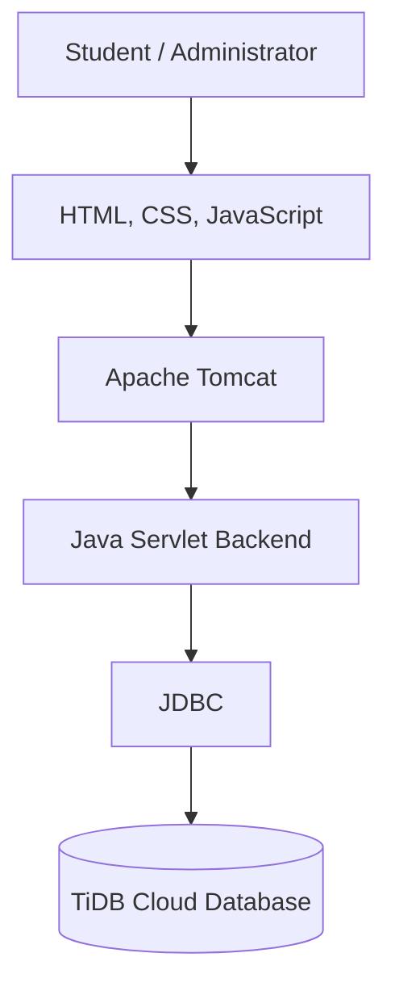
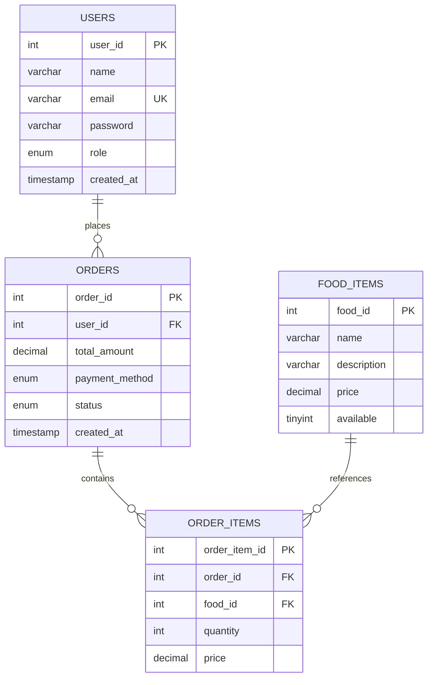

# 🍔 CodeCravers – Canteen Food Ordering System

## 📖 About the Project

CodeCravers is a full-stack Java-based web application designed to digitalize the traditional college canteen food ordering process.

The system allows students to browse food items, manage their shopping cart, place orders, generate bills and view their order history. Administrators can manage food items, prices and availability through a dedicated dashboard.

Developed by a team of three B.Tech CSE (AIML) students at Galgotias University.

## 🌐 Live Website

https://codecravers-canteen.onrender.com/

The application is deployed on Render using Docker and connected to a MySQL-compatible TiDB Cloud database.

## 🎯 Project Objectives

- Digitalize college canteen operations.
- Reduce manual work and waiting time.
- Provide a convenient food ordering experience.
- Automate billing and order management.
- Maintain centralized food and order records.
- Provide role-based access for students and administrators.

## ✨ Key Features

### Student Module

- Student registration and authentication
- Live database-driven food menu
- Shopping cart management
- Automatic price calculation
- Checkout and order placement
- Cash and simulated online payment options
- Automatic bill generation
- Order history

### Admin Module

- Admin authentication
- Dedicated admin dashboard
- Add new food items
- Update food prices
- Manage food availability
- Remove items from the available menu

### Security

- Role-based access control
- PBKDF2 password hashing
- Prepared SQL statements
- Session-based authentication
- Server-side input validation
- CSRF protection
- Environment-based database credentials

## 🛠️ Technology Stack

| Technology | Purpose |
|---|---|
| HTML5 | Website structure |
| CSS3 | Styling and layout |
| JavaScript | Frontend interactivity |
| Java 21 | Backend development |
| Jakarta Servlets 6.0 | Request and response processing |
| JDBC | Database connectivity |
| MySQL | Local database |
| TiDB Cloud | Online relational database |
| Apache Tomcat 10.1 | Application server |
| Maven | Build and dependency management |
| Docker | Containerization |
| Render | Cloud deployment |
| GitHub | Version control |

## 🏗️ System Architecture



The frontend handles user interactions, while Java Servlets process requests and communicate with the cloud database using JDBC.

## 📁 Project Structure

| File | Purpose |
|---|---|
| index.html | Homepage |
| menu.html | Food menu |
| cart.html | Shopping cart and checkout |
| site.css | Website styling |
| assets/ | Website assets |
| CanteenServlet.java | Backend application logic |
| DatabaseConnection.java | JDBC database connectivity |
| PasswordUtil.java | Password hashing utility |
| HelloServlet.java | Servlet connectivity testing |
| database.sql | Database schema |
| web.xml | Web application configuration |
| pom.xml | Maven configuration |
| Dockerfile | Cloud deployment configuration |
| .gitignore | Version control exclusions |
| README.md | Project documentation |
| PROJECT_REPORT_AND_VIVA.md | Project report and viva preparation |

## 🗄️ Database Design

Database Name: `canteen_db`

| Table | Purpose | Primary Key |
|---|---|---|
| users | User accounts and roles | user_id |
| food_items | Food details and prices | food_id |
| orders | Order information | order_id |
| order_items | Individual ordered items | order_item_id |

### Entity Relationship Diagram



## ⚙️ Local Installation and Setup

### Prerequisites

- Java Development Kit 21
- Apache Tomcat 10.1
- MySQL Server
- MySQL Connector/J
- Apache Maven
- Git

### 1. Clone the Repository

```bash
git clone https://github.com/Sanchita1007/CodeCravers-Canteen.git
cd CodeCravers-Canteen
```

### 2. Configure the Database

Execute the `database.sql` file in MySQL Workbench to create the database and required tables.

Add food items to the database using the admin dashboard after configuring an administrator account.

### 3. Configure Environment Variables

| Variable | Value |
|---|---|
| CANTEEN_DB_URL | jdbc:mysql://localhost:3306/canteen_db |
| CANTEEN_DB_USER | Your MySQL username |
| CANTEEN_DB_PASSWORD | Your MySQL password |

Configure these variables before starting Tomcat.

Never commit actual database credentials to GitHub.

### 4. Build the Application

```bash
mvn clean package
```

### 5. Deploy and Run

- Configure JAVA_HOME and CATALINA_HOME.
- Ensure MySQL Server is running.
- Deploy the generated WAR file as Canteen.war in Tomcat's webapps directory.
- Start Apache Tomcat.

Open:

http://localhost:8080/Canteen/

## ☁️ Cloud Deployment

The online application uses:

- Render Docker Web Service
- Apache Tomcat
- Java 21
- MySQL Connector/J
- TiDB Cloud
- Secure TLS database connectivity
- Environment-based database configuration

The hosted application operates independently of the local development computer.

## 🎨 UI/UX Design Principles

- Simplicity
- Consistency
- Visual hierarchy
- Clear navigation
- Readable typography
- Attractive food cards
- Interactive shopping cart
- Clear error messages
- Adaptive layouts using CSS media queries

Formal desktop and mobile responsiveness testing is pending documentation.

## 🧪 Live Website Testing

| Test ID | Feature | Status |
|---|---|---|
| TC01 | Cloud database connectivity | Passed |
| TC02 | Live food menu | Passed |
| TC03 | Student registration | Passed |
| TC04 | Student login | Passed |
| TC05 | Shopping cart | Passed |
| TC06 | Checkout | Passed |
| TC07 | Order placement | Passed |
| TC08 | Automatic billing | Passed |
| TC09 | Order history | Passed |
| TC10 | Admin login | Passed |
| TC11 | Admin dashboard | Passed |
| TC12 | Add food items | Passed |
| TC13 | Update food prices | Passed |
| TC14 | Remove food items | Passed |
| TC15 | Unauthorized admin access prevention | Passed |

**Manual live testing result: 15/15 tests passed.**

## 💡 Innovation and Extra Effort

- Fully hosted Java web application
- Cloud-based relational database
- Docker-based deployment
- Live food availability management
- Automatic billing
- Student order history
- Role-based access control
- Secure external database configuration

## 🚀 Future Scope

- Real online payment integration
- Real-time order tracking
- QR code-based ordering
- Email notifications
- Food ratings and feedback
- Sales analytics dashboard
- AI-based food recommendations

## 👥 Development Team

- **Team Name:** CodeCravers
- **University:** Galgotias University
- **Programme:** B.Tech CSE (Artificial Intelligence and Machine Learning)
- **Team Size:** 3 Members

## 📄 Project Documentation

- [Database Schema](database.sql)
- [Project Report and Viva](PROJECT_REPORT_AND_VIVA.md)

## ✅ Project Status

- Frontend development completed
- Backend development completed
- Database integration completed
- Cloud deployment completed
- Student module tested
- Admin module tested

**Developed by Team CodeCravers | Galgotias University**

